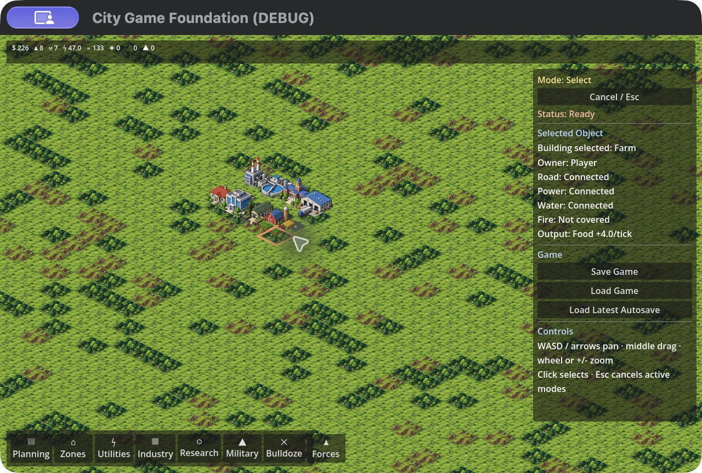
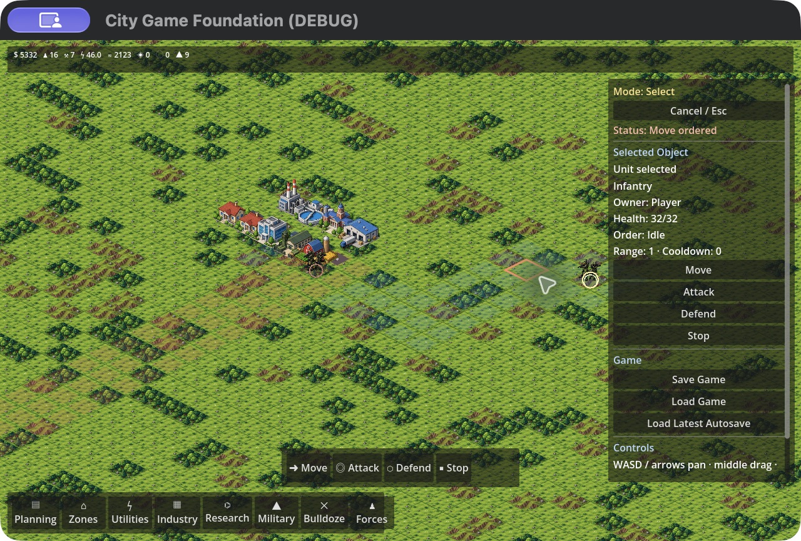

# Gameplay captures

These are unedited screenshots of the actual running Godot project. The terrain, building, and unit art is project-generated artwork whose recovered provenance is documented in [ASSETS.md](ASSETS.md). No image-generation tool was used to make or alter a gameplay screenshot.

## City services

This capture comes from the initial October review. I built the city through ordinary input and selected the farm to inspect its road, power, water, and food-production information. Fire coverage was absent in this city. The capture predates the final popup layout changes.

## Produced unit and commands

This capture comes from the final normal-speed session. The city was built manually, saved, and copied into an isolated playtest. It shows the infantry I manufactured and deployed through the normal inventory, alongside the city and AI forces. The command strip sits above the construction toolbar. Earlier city development was exercised at 2× simulation speed; this is not a claim about campaign duration or difficulty.

The captures demonstrate those specific states. They do not stand in for a completed campaign, measured framerate benchmark, or advanced-weapons demonstration.
